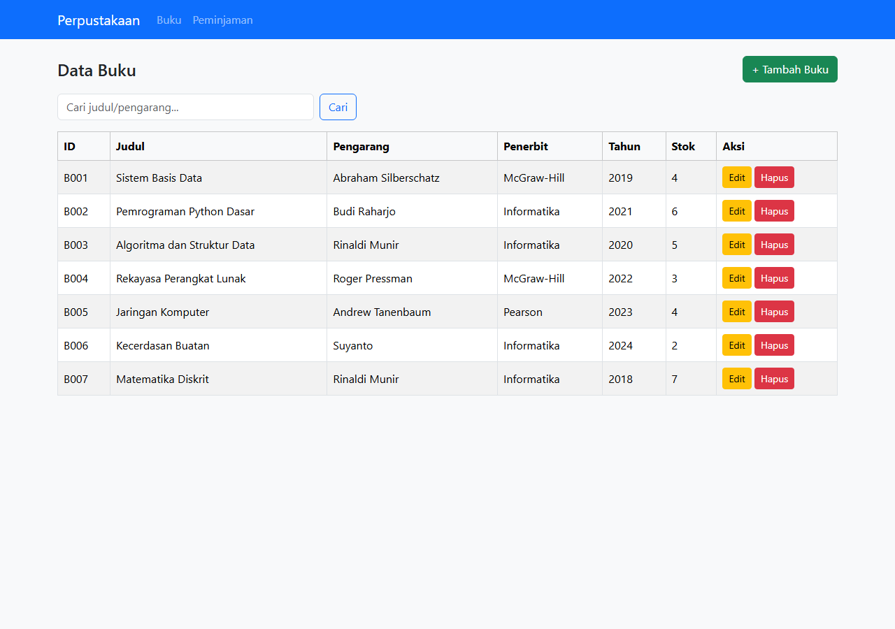
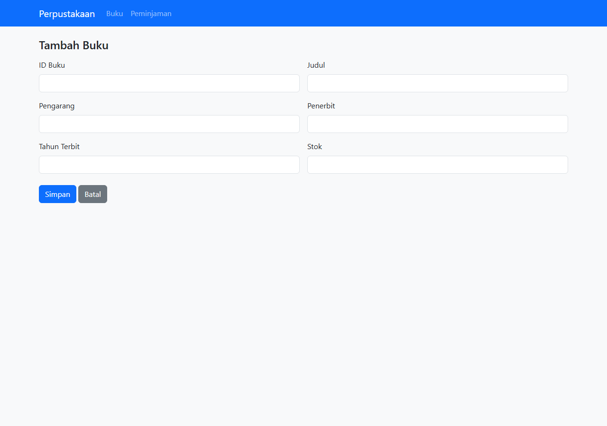
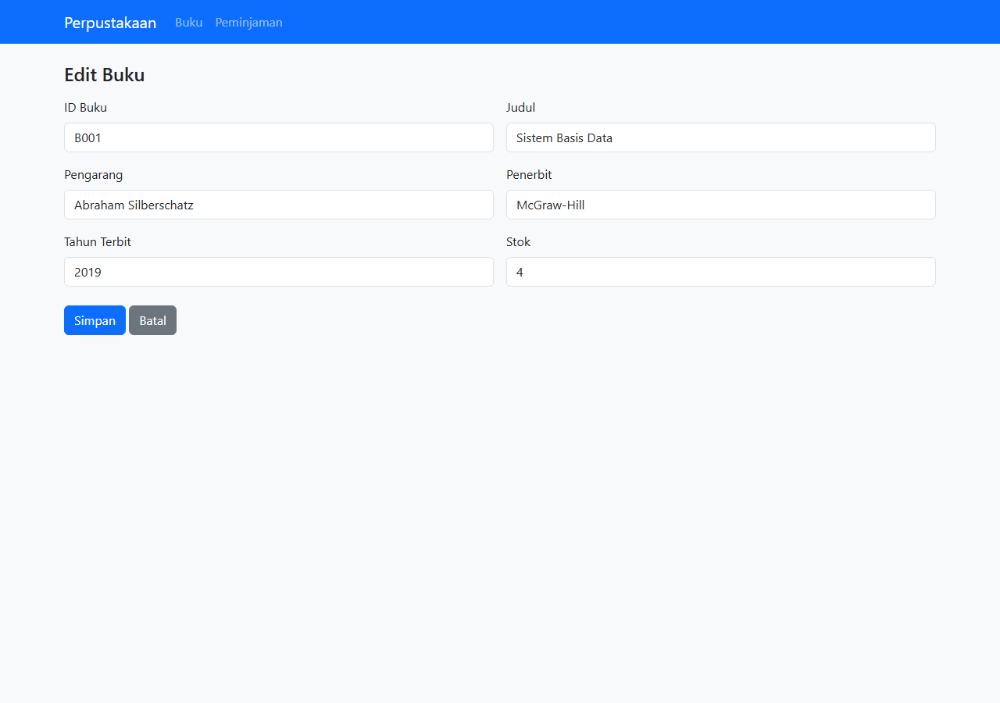
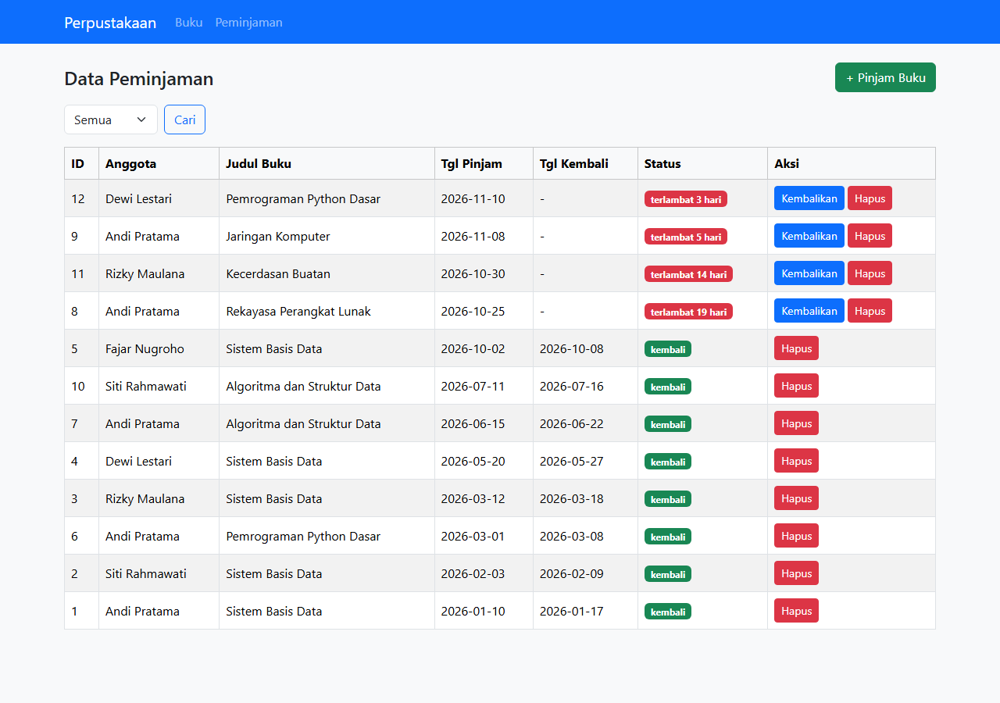
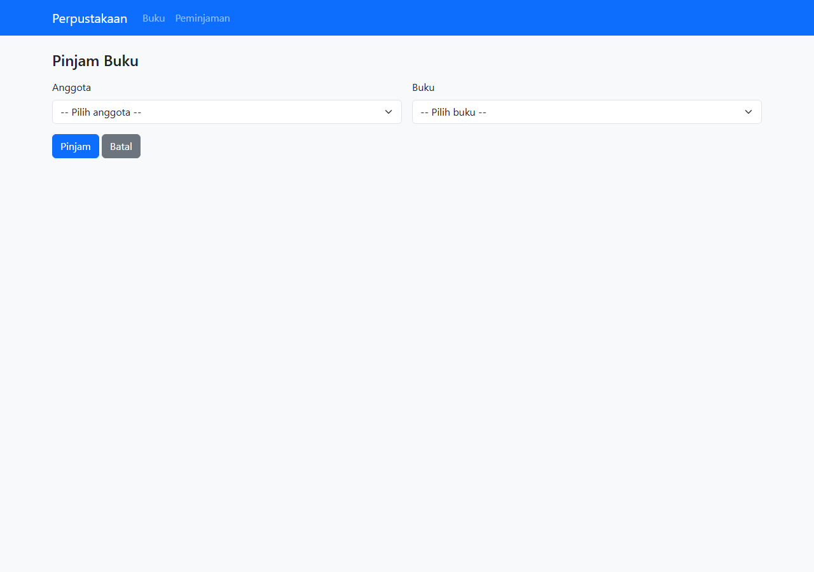

# CRUD Sistem Informasi Perpustakaan (PHP Native)

Tugas mata kuliah **Basis Data** — CRUD Dasar Studi Kasus 1: Sistem Informasi Perpustakaan.

Aplikasi ini mengimplementasikan operasi **Create, Read, Update, Delete** pada basis data `db_perpustakaan` menggunakan **PHP Native** (PDO) dan **Bootstrap 5**.

## Fitur

### Modul Buku
- Menampilkan daftar buku beserta pencarian judul/pengarang.
- Menambah buku baru dengan validasi input.
- Mengubah data buku, kecuali ID buku (primary key).
- Menghapus buku, dengan penolakan jika buku sudah memiliki riwayat peminjaman (foreign key).

### Modul Peminjaman
- Menampilkan transaksi peminjaman dengan `INNER JOIN` ke tabel anggota dan buku.
- Filter status: semua, dipinjam, terlambat, kembali.
- Penanda keterlambatan otomatis (batas pinjam 7 hari).
- Mencatat peminjaman baru dan mengurangi stok buku dalam satu transaksi.
- Memproses pengembalian buku dan menambah stok kembali.
- Menghapus transaksi peminjaman.

## Aturan Bisnis
- Stok berkurang 1 saat buku dipinjam dan bertambah 1 saat dikembalikan.
- Buku dengan stok 0 tidak dapat dipinjam.
- Batas peminjaman 7 hari; keterlambatan dihitung dengan `DATEDIFF(CURDATE(), tgl_pinjam) - 7`.
- ID buku berformat `Bxxx` dan tidak dapat diubah setelah disimpan.
- Buku yang sudah memiliki riwayat peminjaman tidak dapat dihapus (error 1451).

## Struktur Project

```
perpus-php/
├── index.php                 # redirect ke halaman buku
├── config/
│   └── config.php            # koneksi PDO + konfigurasi
├── includes/
│   ├── functions.php         # escape, flash, redirect, validasi
│   ├── header.php            # navbar + pesan flash
│   └── footer.php
├── assets/css/style.css
├── buku/
│   ├── index.php             # READ
│   ├── tambah.php            # CREATE
│   ├── edit.php              # UPDATE
│   ├── hapus.php             # DELETE
│   └── _form.php             # form bersama
├── peminjaman/
│   ├── index.php             # READ (JOIN)
│   ├── tambah.php            # CREATE (transaksi)
│   ├── kembalikan.php        # UPDATE (transaksi)
│   └── hapus.php             # DELETE
├── database/
│   └── db_perpustakaan.sql   # skrip basis data + data awal
└── docs/screenshots/
```

## Cara Menjalankan

1. Jalankan **Apache** dan **MySQL** dari XAMPP.
2. Import `database/db_perpustakaan.sql` melalui phpMyAdmin atau terminal:
   ```
   mysql -u root < database/db_perpustakaan.sql
   ```
3. Letakkan folder project di `C:\xampp\htdocs\perpus-php`.
4. Buka `http://localhost/perpus-php/`.

Alternatif tanpa Apache, jalankan dari folder project:

```
php -S 127.0.0.1:8000
```

lalu buka `http://127.0.0.1:8000/`.

Konfigurasi basis data default mengikuti XAMPP: host `localhost`, user `root`, tanpa kata sandi. Ubah di `config/config.php` bila berbeda.

## Tampilan

### Daftar Buku (Read)


### Tambah Buku (Create)


### Edit Buku (Update)


### Daftar Peminjaman (Read dengan JOIN)


### Pinjam Buku (Create)


## Keamanan dan Konsistensi Data
- Seluruh query memakai **prepared statement** PDO.
- Input divalidasi di sisi server.
- Output di-escape dengan `htmlspecialchars` untuk mencegah XSS.
- Operasi yang mengubah dua tabel dibungkus **transaksi** dengan `SELECT ... FOR UPDATE`.
- Pola **Post/Redirect/Get** diterapkan agar data tidak terkirim ulang saat halaman di-refresh.
